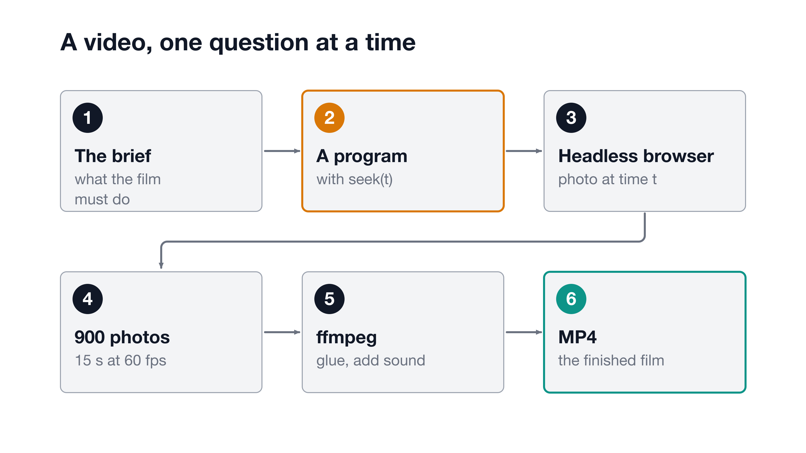
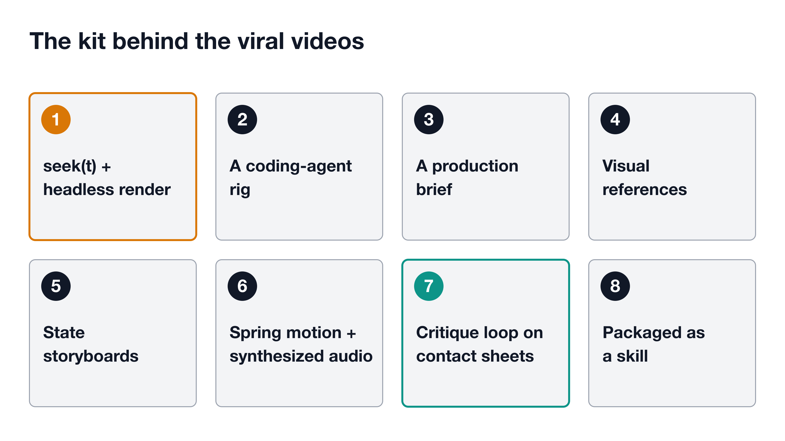
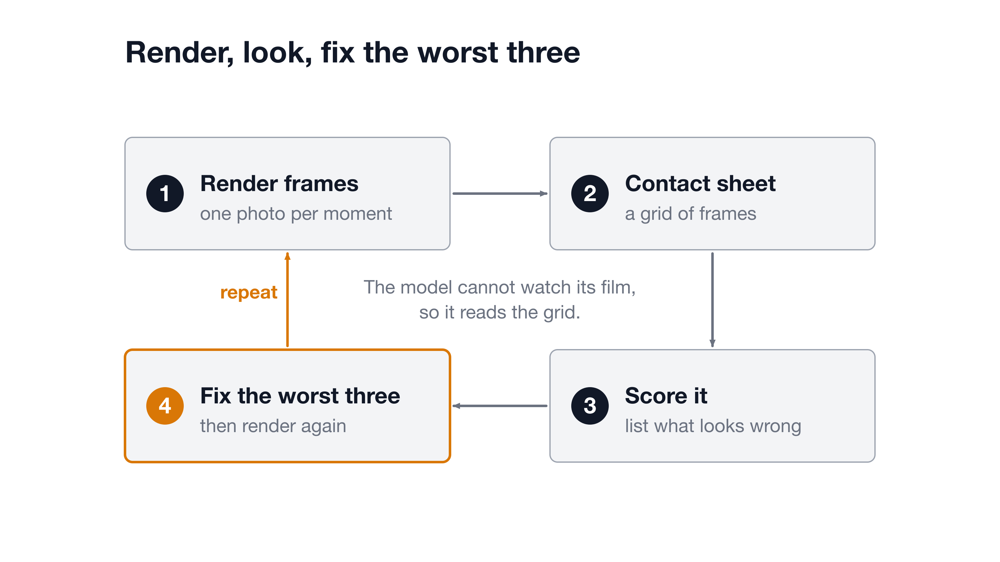

# The Video Is a Program

**How a coding model makes a film it cannot see: it writes a function that knows what any moment looks like.**

   
  ▶ <a href="video/the-video-is-a-program.mp4">Watch the explainer video (MP4)</a> · <a href="video/the-video-is-a-program.srt">captions</a>

A music video made from one prompt reached 2.1 million views (the post says). The model that made it cannot output a video file. It wrote a program instead. After this page you can explain the trick, and you will have seen it used on the video at the top.

## The one idea

> Do not ask for a video. Ask for the picture at time t, then ask nine hundred times.

The model writes a small program with one key function, called seek. You hand seek a time, and it sets every shape, word and color to exactly how the scene should look at that instant. A browser with no window takes a photo of the result. A program called ffmpeg, which joins pictures and sound into one file, glues the photos into a film and lays the audio underneath.

<picture>
  <source media="(prefers-color-scheme: dark)" srcset="diagrams/seek-pipeline-dark.png">
  
</picture>

*From a brief to an MP4, one question per frame: what does the screen look like at time t?*

## What the model actually writes

A text model produces text. It cannot hand you an MP4, the common video file format. So the text it writes is a program: HTML (the structure of a web page), CSS (its styling) and a little JavaScript (code that makes things move). The post says the model has no way to output an MP4, and that every viral clip is a program some other tool turned into pictures.

The special piece is the seek function. It answers one question: what does the screen look like at this moment? Nothing in the program runs on a timer, so any moment can be drawn on its own.

There is a catch. The model never sees the video it is making. Three things do the seeing for it. The brief says what the film must do. The references show what it should look like. The critique loop, covered below, feeds pictures of the result back for it to judge. The post says that feedback loop is the gap between the viral clips and the forgettable ones.

The post also names the limits: lifelike scenes, detailed characters and natural movement are better served by real footage or a video model.

## From one function to nine hundred frames

A frame is one still picture. A 15-second clip at 60 frames per second is 900 frames, and the post says a headless browser calls seek 900 times. A headless browser is an ordinary web browser running without a window. It loads the program once, then for each frame calls seek with the next time and saves a screenshot. [Playwright's screenshot guide](https://playwright.dev/docs/screenshots) shows how a script takes those photos. Then [ffmpeg](https://ffmpeg.org/) reads the numbered pictures in order, joins them into a film and adds the sound. Look back at the diagram above: that is the whole machine.

The property that makes it work is determinism, which means the same input always gives the same output. The same t gives the same picture every time. So frames do not depend on each other. You can render them in any order, or redo a single one.

The post puts the benefit in practical terms: you can render frame 240 without drawing the 240 frames before it, and if a title appears too early, you change one number and render again.

## The eight pieces of the kit

The post lists eight pieces. Here they are in plain words.

<picture>
  <source media="(prefers-color-scheme: dark)" srcset="diagrams/eight-pieces-dark.png">
  
</picture>

*The kit behind the viral videos: the prompt is one piece of eight.*

1. **A seekable frame function.** The program described above, plus a headless browser and ffmpeg to turn it into a file.
2. **A coding-agent rig.** A chat window can write the animation but cannot run it. The post used Claude Code, an AI tool that can run commands and read files, with a project instructions file it reads every time.
3. **A production-style brief.** A document that makes the decisions. Without one, the post says, the model fills every blank with its safest default.
4. **Visual references.** A frame, a short clip or a folder of past work, so the film does not look like everyone else's.
5. **State-based storyboards.** For each moment, say what is on screen and why, not which effects to apply.
6. **Spring-based motion with synthesized audio.** A spring moves like an object with weight: it speeds up, overshoots slightly and settles. The sound is generated by code on the same clock as the picture.
7. **A self-critique loop on contact sheets.** Covered next.
8. **Packaging it as a reusable skill.** Save the pipeline and the decisions in files, so the next film starts from them instead of from zero.

## The critique loop: render, look, fix the worst three

The model cannot watch its film, but it can read an image. So ffmpeg builds a contact sheet: one picture holding a grid of frames from across the film, like a photographer's proof sheet.

<picture>
  <source media="(prefers-color-scheme: dark)" srcset="diagrams/critique-loop-dark.png">
  
</picture>

*Four steps, then back to the start.*

The model scores the sheet, picks the worst three problems, fixes them and renders again (the post says). The post gives no reason for the limit of three. This page's reading is that a short list is easier to act on than a long one. The post lists what to hunt for: overlapping text, blurry text, a stretch where nothing happens, a stutter where the clip loops.

The post says the viral clips all went through this step. People skip it, it adds, because the first render feels like progress.

## What the viral runs had in common

Everything here is what the post says, from one author's account. This page did not check it independently.

- **Long briefs, not one-liners.** The post says the model, which it calls Opus 5.5, was released on September 22, and that the one-prompt captions hid the real inputs. It says a 142-second music video, by a creator it calls Donald, reached 2.1 million views from a prompt of about 9,500 characters.
- **Higher effort settings.** The post says the model starts on a medium setting, and the viral runs used higher ones.
- **Overnight runs.** The post says the best runs kept working for hours while the author slept.
- **Real skills and API keys.** An API key is a password that lets a program use a paid service. The post says the best runs came with a skills folder and two of them.

The post also says the 142-second piece used Seedance 2.5, a video model, for some base shots, with the code-rendered method doing the rest.

The post's cost anchor: a similar launch video cost one maker it names, Tony Dinh, about $1,200 a year earlier.

## This video was made this way

The video at the top of this page is rendered with this repo's own tools, by the same method.

- `motion.js` is a tiny timeline. Its seek(t) recomputes every property from scratch, with no clocks and no dependencies.
- `render.mjs` drives a headless Chromium browser through Playwright and saves one JPEG per frame, at 30 frames per second and 1920 by 1080 pixels.
- `make_video.sh` records narration with the Mac's built-in speech voice, then glues frames and voice together with ffmpeg. There is no music.
- The contact sheet in `video/contact.png` is the critique loop.

No GSAP, no Remotion, no network at render time. If you would rather not write the plumbing, [HyperFrames](https://github.com/heygen-com/hyperframes) and [Remotion](https://github.com/remotion-dev/remotion) do the same job as ready-made frameworks.

## In the words engineers use

| Plain words in this article | What engineers say | One line |
|---|---|---|
| A function that knows any moment | `seek(t)`, a pure function of time | Same t in, same picture out. |
| A browser with no window | Headless browser | Runs a page with no screen, so a script can photograph it. |
| A photo of one instant | Frame capture, screenshot | One image per call to seek. |
| Same every time | Deterministic rendering | Frames can be redone or reordered safely. |
| Glue photos into a film | Encoding with ffmpeg | Turns numbered images and audio into one file. |
| A grid of frames | Contact sheet | A quick way to review a whole film in one image. |
| The rules file | Project instructions file | Text the agent reads at the start of every run. |
| What is on screen in each moment | State-based storyboard | Describe states, not effects. |
| Motion with weight | Spring easing | Overshoots slightly, then settles. |
| A saved recipe | Skill | The pipeline kept in files for reuse. |

## Go deeper

- [The original post](https://x.com/seeconvm/status/2106096193235259564): the full setup, with the details this page left out.
- [HyperFrames](https://github.com/heygen-com/hyperframes): a framework that turns HTML into video using the same seek-and-capture idea.
- [Remotion](https://github.com/remotion-dev/remotion): the React-based take on video as a function of the frame number.
- [Playwright screenshots](https://playwright.dev/docs/screenshots): how a script photographs a web page.
- [FFmpeg formats](https://ffmpeg.org/ffmpeg-formats.html): how ffmpeg reads a numbered image sequence.
- [What Ships](https://whatships.com): a directory of launch videos, which the post suggests for finding references.

## Sources

- seeco (@seeconvm), X, 2:57 PM · Oct 2, 2026, https://x.com/seeconvm/status/2106096193235259564
- heygen-com/hyperframes, GitHub, retrieved 2026-10-16, https://github.com/heygen-com/hyperframes
- remotion-dev/remotion, GitHub, retrieved 2026-10-16, https://github.com/remotion-dev/remotion
- Playwright screenshots guide, playwright.dev, retrieved 2026-10-16, https://playwright.dev/docs/screenshots
- FFmpeg formats: image2 and concat demuxers, ffmpeg.org, retrieved 2026-10-16, https://ffmpeg.org/ffmpeg-formats.html
- What Ships, whatships.com, retrieved 2026-10-16, https://whatships.com
- `motion.js`, `render.mjs` and `make_video.sh` in this project's tools folder, read 2026-10-16

*Written by Wilson Wu with Claude. The diagrams and the explainer video were generated from the same brief as this article; the video is rendered frame by frame from a small program in `video/`.*
